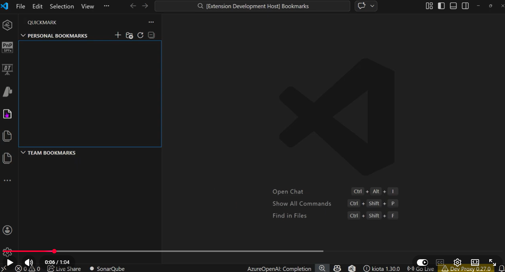

# QuickMark

> VS Code bookmark manager for files, links, and team-shared project resources.

## What the extension does

QuickMark helps you keep the tools, docs, and files you rely on for a project close at hand inside VS Code.

Instead of scattering important links across README files, chat threads, or browser bookmarks, QuickMark lets you:

- save workspace files as bookmarks
- save external URLs such as docs, dashboards, tickets, and design systems
- organize bookmarks into groups
- keep personal bookmarks separate from team-shared bookmarks
- search and open bookmarks without leaving the editor
- detect missing files and surface them as a dedicated "Deleted Files" group

This keeps navigation fast for both individual work and shared team workflows.

## Overview

[](https://youtu.be/yVEOKb1dW2s)

## Features

### Core feature set

| Feature | Description |
|---|---|
| File and URL bookmarks | Save any workspace file or external link with a click. |
| Personal + team storage | Keep private items in VS Code settings and shared items in the repo root `QuickMark.json`. |
| Grouping | Organize bookmarks into project-specific groups like Docs, CI/CD, Design, and QA. |
| Search | Use the command palette to quickly find any bookmark by name or target. |
| Explorer integration | Add a file directly from the Explorer context menu. |
| Cross-storage moves | Move bookmarks between personal and team storage as needed. |
| Deleted file tracking | Missing file entries are grouped under a clear "Deleted Files" section. |

### Feature walkthrough with screenshots

The extension is designed to live in the VS Code sidebar, so your important project links stay visible while you work.


This screenshot shows:

- the QuickMark activity bar panel
- personal and team bookmark groups
- file and URL entries in a structured layout
- a practical workflow for keeping reference links near the code they support

## Installation

### From VS Code Marketplace

1. Open VS Code.
2. Open the Extensions view with `Ctrl+Shift+X`.
3. Search for `QuickMark`.
4. Click `Install`.

### From a local VSIX package

If you are developing locally:

```bash
npm install
npm run build
npm run package
```

Then install the generated `.vsix` file in VS Code via the Extensions panel or the command line:

```bash
code --install-extension quickmark-<version>.vsix
```

## Usage examples

### Add a file bookmark

1. Click the QuickMark icon in the Activity Bar.
2. Use the `+` button in Personal or Team.
3. Choose `File in workspace`.
4. Select a file.
5. Enter a display name if needed.
6. Save it to a group or keep it ungrouped.

The bookmark opens the file directly when selected.

### Add a URL bookmark

1. Open QuickMark.
2. Click `+`.
3. Choose `URL / Link`.
4. Paste the full URL.
5. Add a custom title.
6. Save it to Personal or Team.

The bookmark opens in the browser or in VS Code's simple browser when available.

### Create and organize groups

1. Use `QuickMark: Create Group` or the `+` button in a storage pane.
2. Name the group, such as `Docs`, `Dashboards`, or `Design`.
3. Save new bookmarks to that group.
4. Rename or remove groups from the context menu.

### Search bookmarks quickly

Use:

- `QuickMark: Search Bookmarks` from the Command Palette
- or the QuickMark sidebar search/discovery workflow

This helps when a repo has many links and you need to jump to a specific resource without leaving the editor.

### Move bookmarks between personal and team storage

Right-click a bookmark and choose:

- `Move to Personal`
- `Move to Team`

This is useful when a resource starts as personal and later becomes a team-wide reference.

## Configuration options

QuickMark exposes the following setting:

| Setting | Default | Description |
|---|---|---|
| `quickmark.personalStorageScope` | `"workspace"` | Controls where personal bookmarks are stored: `"workspace"` or `"global"`. |

### Example

```json
{
  "quickmark.personalStorageScope": "global"
}
```

This stores personal bookmarks in the user settings instead of the current workspace settings file.

## Storage model

### Personal bookmarks

Personal bookmarks are stored in your VS Code settings. By default they are saved to workspace settings (`.vscode/settings.json`), but you can switch to global user settings with the configuration value above.

### Team bookmarks

Team bookmarks are stored in a file named `QuickMark.json` at the workspace root. This file is intended to be committed to version control and shared across the repo.

## Known issues

The extension is intentionally lightweight, but a few limitations currently exist:

- Team bookmarks require an open workspace folder; without a workspace, `QuickMark.json` cannot be written.
- Deleted file detection is best-effort and depends on current workspace state.
- File bookmarks are resolved relative to the first workspace folder in the project.
- URL opening may fall back to the system browser when VS Code's Simple Browser is not available.
- The extension currently supports flat groups (no nested groups).

## Contribution guidelines

Contributions are welcome.

### Development setup

```bash
npm install
npm run build
npm run watch
```

Then press `F5` in VS Code to launch the Extension Development Host and test the extension.

### Workflow

1. Fork the repository and create a feature branch.
2. Keep changes focused and avoid unrelated refactors.
3. Update README docs if behavior or configuration changes.
4. Run the project checks before submitting a PR.
5. Open a pull request with a short summary of the problem and the fix.

### Code quality expectations

- Prefer small, readable changes
- Keep commands and storage logic clear and testable
- Follow the naming conventions already used in the extension
- Preserve the personal/team storage separation

### Pull request checklist

- README updated when user-facing behavior changes
- build passes
- no unrelated files changed
- clear description of what changed and why

## Development commands

```bash
npm install
npm run build    # one-time build
npm run watch    # watch for changes
npm run lint    # TypeScript validation
npm run package  # create a VSIX package
```

## License

MIT
